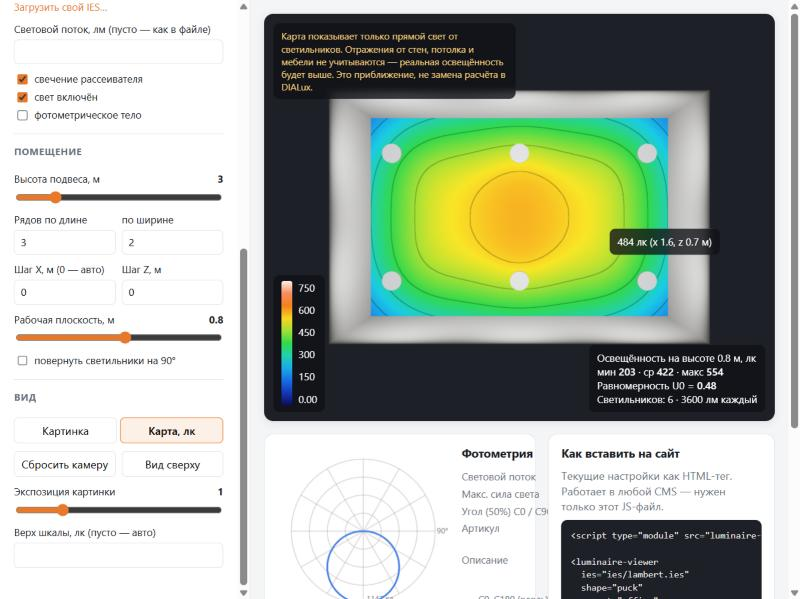

# Light Viewer

Прототип встраиваемого модуля для сайта производителя светильников: **3D-модель светильника, свет по IES-файлу и карта освещённости в люксах**. Всё это работает в браузере, подключается одним тегом.

```html
<script type="module" src="luminaire-viewer.standalone.js"></script>

<luminaire-viewer ies="ies/lambert.ies" lumens="3600" shape="puck" preset="office" view="lux"></luminaire-viewer>
```

Подробный отчёт (что умеет Three.js, как у конкурентов, разбор diora.pro, точность, юридические вопросы): **[docs/REPORT.md](docs/REPORT.md)**.



## Запуск

Нужен Node.js 20+ (проверено на 22.12).

```bash
npm install
```

```bash
npm run dev
```

Откроется демо на `http://localhost:5173`. Вторая страница `http://localhost:5173/embed.html` показывает вставку в обычный HTML без React.

| Команда | Что делает |
|---|---|
| `npm run dev` | Демо с горячей перезагрузкой |
| `npm test` | Unit-тесты (vitest): парсер IES и расчёт освещённости |
| `npm run typecheck` | Проверка типов TypeScript |
| `npm run build` | typecheck + сборка библиотеки (`dist/lib`) + сборка демо (`dist/demo`) |
| `npm run preview` | Посмотреть собранное демо |
| `npm run gen:ies` | Пересоздать тестовые IES-файлы в `demo/public/ies` |
| `npm run gen:glb` | Пересоздать пример GLB-модели в `demo/public/models` |
| `node scripts/check-three-iesloader.mjs` | Показать, как `IESLoader` из three искажает распределение |

## Что умеет

- **3D-модель**: GLB/GLTF (в том числе со сжатием meshopt) или процедурная заглушка: линейный светильник, «таблетка», прожектор. Вращение и зум мышью, свечение рассеивателя вкл/выкл.
- **IES (LM-63)**: свой парсер всех версий формата. Сила света в любом направлении с учётом симметрий. Световой поток, угол пучка, полярная кривая (КСС), 3D-фотометрическое тело. Можно задать свой поток (`lumens`): распределение отмасштабируется.
- **Помещение**: пресеты «студия», «офис 6×4×3», «склад 24×12×8», «улица». Высота подвеса, сетка светильников, шаг, рабочая плоскость, поворот.
- **Карта освещённости**: цветная карта с изолиниями и легендой; мин / среднее / макс / U0; люксы в точке под курсором. Считается **только прямой свет**, об этом есть надпись в интерфейсе.

## Атрибуты `<luminaire-viewer>`

| Атрибут | Пример | Смысл |
|---|---|---|
| `ies` | `ies/lambert.ies` | Адрес IES-файла |
| `lumens` | `3600` | Световой поток, лм (без атрибута — как в файле) |
| `model` | `models/x.glb` | Адрес GLB; без атрибута используется заглушка |
| `shape` | `linear` / `puck` / `flood` | Форма заглушки |
| `preset` | `studio` / `office` / `warehouse` / `street` | Помещение |
| `mount-height` | `2.8` | Высота подвеса, м |
| `count-x`, `count-z` | `3`, `2` | Сетка светильников |
| `spacing-x`, `spacing-z` | `2` | Шаг, м (0 — равномерно по помещению) |
| `workplane` | `0.8` | Высота рабочей плоскости, м |
| `rotated` | `true` | Повернуть светильники на 90° |
| `view` | `render` / `lux` | Картинка или карта в люксах |
| `glow`, `light`, `solid` | `false` | Свечение рассеивателя, свет, фотометрическое тело |
| `exposure` | `1.5` | Яркость картинки |
| `max-lux` | `500` | Верх цветовой шкалы, лк |

События: `lv-update` (в `event.detail` статистика и параметры), `lv-error` (текст ошибки). Для управления из JS есть свойство `element.viewer`: это ядро `LuminaireViewer` (`resetCamera()`, `topView()`, `setIesText()` …).

## Путеводитель по коду

Читать лучше в таком порядке, от простого к сложному:

1. **`src/core/ies-parser.ts`** — как устроен IES-файл и как его прочитать. Чистый TypeScript, без Three.js.
2. **`src/core/photometry.ts`** — «сила света в направлении (γ, C)»: интерполяция таблицы, симметрии, световой поток.
3. **`src/core/illuminance.ts`** — главная формула `E = I·cos α / d²` и расчёт сетки. Рядом **`tests/illuminance.test.ts`**: там тот же расчёт вручную, по шагам.
4. **`src/core/room.ts`** — пресеты помещений и расстановка светильников сеткой.
5. **`src/core/lighting-material.ts`** — та же формула, но в шейдере GLSL: считает освещённость для каждого пикселя пола и стен.
6. **`src/core/models.ts`** — заглушки и загрузка GLB.
7. **`src/core/viewer.ts`** — собирает всё в сцену Three.js: камера, помещение, светильники, пересчёт.
8. **`src/element.ts`** — веб-компонент `<luminaire-viewer>`: атрибуты → вызовы ядра, легенда и статистика.
9. **`demo/src/App.tsx`** — React-демо: только панель, которая меняет атрибуты компонента.

Вспомогательное: `src/core/colormap.ts` (цветовая шкала), `src/core/photometric-shapes.ts` (КСС и фотометрическое тело), `src/core/ies-writer.ts` + `src/core/test-distributions.ts` (генерация тестовых IES).

```
src/
  core/          ядро: без React, можно использовать где угодно
  element.ts     веб-компонент
  index.ts       что экспортирует библиотека
  register.ts    точка входа «подключил — тег заработал»
demo/            демо на Vite + React
tests/           vitest
scripts/         генерация тестовых файлов, проверка IESLoader
docs/            отчёт и скриншоты
```

## Подводные камни

- **Оси.** Y — вверх, светильник смотрит вниз (−Y), плоскость C0 идёт вдоль оси X светильника. GLB-модель нужно так и ориентировать: низ рассеивателя в начале координат.
- **Свечение GLB.** Кнопка «свечение» находит рассеиватель по имени меша или материала (`diffuser`, `lens`, `emit`) или по уже заданной эмиссии.
- **Большие модели из CAD** (размер > 20 единиц) считаются миллиметровыми и уменьшаются в 1000 раз.
- **Draco** не подключён: для него нужно выложить wasm-декодер. Используйте meshopt.
- **Размер:** `luminaire-viewer.js` без three весит ~44 КБ; standalone-версия с three — ~830 КБ (~195 КБ gzip).
- **Точность:** только прямой свет, без отражений и коэффициента эксплуатации; подробно в отчёте, раздел 5.
