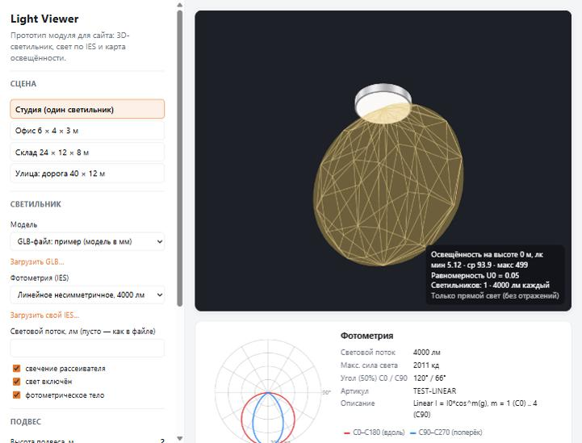
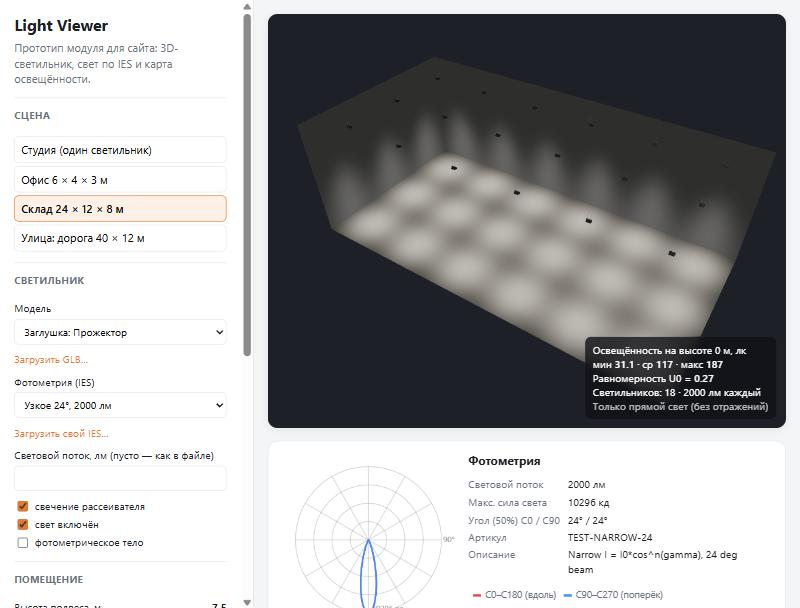
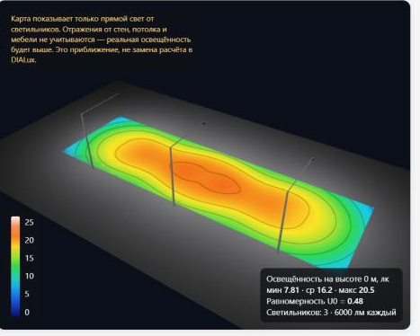

# Light Viewer: отчёт по прототипу

*Дата: 28.10.2026. Обозначения: ✅ проверено своими руками (код, запуск, страница сайта); 🔎 по памяти или из общих знаний, перед решениями стоит перепроверить.*

## Коротко

- Сделан работающий прототип модуля для сайта. Он показывает 3D-модель светильника (GLB или заглушку), распределение света по IES-файлу, помещение с сеткой светильников и **карту освещённости в люксах** со статистикой (мин / среднее / макс / U0).
- Модуль подключается **одним тегом** `<luminaire-viewer …>` на любой странице. Текущий сайт на MODX, будущий может быть на чём угодно: фреймворк не нужен.
- Готовые решения Three.js для IES оказались **непригодны для расчёта** (подробности ниже). Поэтому парсер IES и расчёт освещённости написаны свои и покрыты тестами со сверкой с ручным расчётом.
- Главное, что нужно от компании: **IES-файлы по отдельным моделям** (сейчас они лежат одним архивом на 184 МБ) и **3D-модели в GLB**.

Скриншоты: [docs/screenshots](screenshots/).

| Светильник (GLB) со свечением | Офис: карта, лк | Склад | Улица |
|---|---|---|---|
|  |  |  |  |

---

## 1. Что умеет Three.js с IES и что пришлось сделать самим

Проверено на версии **three r186** (npm `three@0.186.1`), по исходному коду в `node_modules` и запуском ✅.

### Что есть в Three.js

| Компонент | Где лежит | Что делает |
|---|---|---|
| `IESLoader` | `three/addons/loaders/IESLoader.js` | Читает IES и превращает его в текстуру 180 × 1 для `IESSpotLight` |
| `IESSpotLight` | `three/webgpu` (`src/lights/webgpu/IESSpotLight.js`) | Прожектор, у которого яркость по углу берётся из IES-текстуры |
| `IESSpotLightNode` | `src/nodes/lighting/IESSpotLightNode.js` | Шейдерная часть: подменяет «конус прожектора» выборкой из текстуры |

Ссылки: [документация IESSpotLight](https://threejs.org/docs/#IESSpotLight), [официальный пример](https://threejs.org/examples/webgpu_lights_ies_spotlight.html) ✅ (страницы открываются).

### Ограничения (проверено ✅)

1. **`IESSpotLight` работает только с `WebGPURenderer`.** Так написано в комментарии к классу, и он регистрируется только в библиотеке нод WebGPU. Сам `WebGPURenderer` умеет откатываться на WebGL 2 (`WebGLBackend`, опция `forceWebGL`), но это другой рендерер, не привычный `WebGLRenderer`.
2. **`IESLoader` возводит силу света в квадрат.** В коде стоит `candela *= candela * multiplier * …` вместо `candela *= multiplier * …`. Проверка скриптом `scripts/check-three-iesloader.mjs` на нашем косинусном файле:

   | γ | IESLoader | ожидаемо (cos γ) | cos² γ |
   |---|---|---|---|
   | 30° | 0.750 | 0.866 | 0.750 |
   | 60° | 0.250 | 0.500 | 0.250 |
   | 120° | **−0.046** | 0 | — |

   Форма кривой искажается, а за пределами таблицы получаются **отрицательные** значения: функция экстраполирует, а не обнуляет.
3. **Учитывается только одна C-плоскость.** Загрузчик считает массив 360 × 180, но в текстуру 180 × 1 попадает только плоскость C0. Для несимметричных светильников (линейные, уличные с боковой КСС) это неверно.
4. **Значения нормируются на максимум.** Абсолютную силу света нужно задавать отдельно через `intensity`. Множители и коэффициенты балласта при этом всё равно перемножаются и пропадают при нормировке.
5. Наклон прожектора ограничен `angle ≤ π/2`: так устроен `SpotLight`, на котором основан `IESSpotLight`. 🔎 Влияет ли этот конус на IES-вариант, по коду до конца не проверял.
6. Люксов нет вообще: это инструмент «чтобы было красиво», а не расчёт.

### Что сделано самим

| Файл | Что делает |
|---|---|
| `src/core/ies-parser.ts` | Парсер LM-63 (1986/1991/1995/2002): ключевые слова, `TILT=INCLUDE`, числа через пробел и запятую с любыми переносами строк, футы → метры, множители. Понятные ошибки на русском |
| `src/core/photometry.ts` | I(γ, C) с билинейной интерполяцией и всеми симметриями LM-63 (осевая, квадрантная, 0–180, 90–270, полная с замыканием 360°). Световой поток интегрированием, угол половинной силы света, масштаб под заданные люмены |
| `src/core/illuminance.ts` | Расчёт `E = I(γ,C)·cos α / d²`, сумма по светильникам, сетка, статистика |
| `src/core/lighting-material.ts` | Шейдер для пола и стен, который **в каждом пикселе** считает освещённость по той же формуле. Картинка и карта в люксах построены на одних и тех же числах |
| `src/element.ts` | Веб-компонент `<luminaire-viewer>` |

Работает на обычном `WebGLRenderer` (WebGL 2), то есть в любом современном браузере без WebGPU.

---

## 2. Как это делают другие производители

| Производитель | Что проверено | Что на сайте |
|---|---|---|
| **Световые Технологии** (ltcompany.com), Россия | ✅ страница серии HB LED G3 | Для каждой серии отдельные архивы: КСС в **IES**, **LDT** (Eulumdat) и **JPG**, плюс сертификаты и фото. 3D-просмотра или расчёта на странице нет (WebGL-библиотек не нашёл) |
| **ERCO** (erco.com), Германия | ✅ частично: страница Eclipse 48V и раздел загрузок | На странице семейства есть **онлайн-конфигуратор шинопроводов**. Раздел загрузок с данными для расчёта, в том числе фотометрическая база для AGI32. 🔎 Состав файлов по каждому артикулу (IES/LDT/3D-CAD) не открывал |
| **iGuzzini** (iguzzini.com), Италия | ✅ поверхностно: страница Laser Evo | Упоминается IES. 🔎 Есть ли 3D-просмотр, не установил |
| **Signify (Philips), Zumtobel, Flos** | 🔎 не проверял | По памяти: фотометрия для DIALux/Relux, у некоторых онлайн-конфигураторы. Перепроверить, если нужно для презентации |

**Вывод.** У крупных производителей стандарт такой: **IES/LDT на странице каждого изделия** плюс CAD/BIM. Интерактивные «посмотри, как светит, прямо на сайте» встречаются редко (у проверенных не нашёл), так что это возможность выделиться. 🔎 Утверждение «встречается редко» основано на 3–4 сайтах, не на обзоре рынка.

---

## 3. Текущий сайт diora.pro (✅ открыт 28.10.2026)

- **Ассортимент:** промышленное, уличное, офисное, архитектурное, торговое, ЖКХ, спортивное, аварийное, взрывозащищённое, складское, фитоосвещение, морской регистр, постоянный ток. На главной: «17598+ моделей светильников» (много модификаций одной серии: мощность × поток × цветовая температура × КСС).
- **На чём сделан:** в коде страниц подключаются компоненты `minishop2`, `ajaxform`, `easycomm`, `minifyx`. Это дополнения для **MODX Revolution**, отсюда вывод, что CMS — MODX (явно на страницах это не написано). Есть jQuery 3.2.1, Swiper. Сайт за `ddos-guard`.
- **Карточка товара** (пример: LPO/LSP 28/3700): технические характеристики, тип КСС текстом («косинусная Д»), таблица модификаций, «Материалы для скачивания» (там сертификаты и декларации в PDF). **IES-файла и 3D на странице товара нет.**
- **Раздел «Скачать»** (`/downloads/`): **все IES одним RAR-архивом на 184 МБ**; BIM-модели (Revit, RFA/ZIP) по 12 сериям (Zevs, Meduza, Caiman, Skat, Quadro, Piton, LPO/LSP SE, Craft, Office SE, NPO SE, Angar…); DWG-чертежи одним архивом; паспорта и сертификаты архивами. Страница «Проектировщикам» ведёт туда же.

**Что это значит для модуля.** Исходные данные у компании есть: IES и BIM-модели. Их нужно разложить по артикулам, а 3D перевести из Revit/CAD в GLB.

---

## 4. Что потребуется от компании

### 3D-модели
- **Из чего:** модели уже есть в Revit (RFA) для части серий и в DWG. Конструкторские модели, скорее всего, в CAD (SolidWorks, КОМПАС-3D, Inventor; уточнить у конструкторов).
- **Путь конвертации (🔎 инструменты перепроверить):** CAD → **STEP** → Blender (импорт STEP) или CAD Exchanger / FreeCAD → упростить (убрать винты, внутренности, платы) → экспорт **glTF/GLB** → сжатие **meshopt** или **Draco** утилитой `gltf-transform`.
- **Что важно в модели:**
  - единицы — метры (модуль сам распознаёт миллиметры и уменьшает в 1000 раз);
  - низ светящей поверхности в начале координат, светильник смотрит вниз, длинная сторона вдоль оси X (плоскость C0);
  - меш или материал рассеивателя назван `diffuser`, `lens` или `emit`, иначе не будет работать кнопка «свечение».
- **Сжатие:** в прототипе подключён **meshopt**: декодер встроен в three/addons, отдельных файлов не нужно. Draco требует размещать wasm-декодер на сайте, пока не подключён.
- **Сколько моделей:** не на каждую из 17 тысяч модификаций, а **по одной на корпус** (серию и типоразмер). Модификации отличаются потоком и КСС, а это задаётся IES-файлом и атрибутом `lumens`.

### IES-файлы
- По одному на **каждую оптику** (КСС) каждой серии, с понятным именем: артикул или серия + КСС.
- Желательно **абсолютная фотометрия** (LED, `lumens per lamp = -1`) или явно указанный поток. Для модификаций одной серии с одинаковой оптикой хватит одного файла и масштабирования по потоку: модуль это умеет (атрибут `lumens`).
- Если фотометрия есть только в LDT (Eulumdat): парсер LDT пока не написан, это следующий шаг.

### Данные для карточки
- Связка «артикул → файл модели + IES + световой поток». Это одна таблица (или поле в MODX), из которой генерируется тег `<luminaire-viewer>`.

---

## 5. Ограничения и точность. Насколько далеко от DIALux

**Что считается:** только **прямая** освещённость `E = I(γ,C)·cos α / d²` от каждого светильника, сумма по всем. Сверено с ручным расчётом в тестах (точка под светильником, под 45° и 60°, вертикальная поверхность, сумма двух и четырёх светильников).

**Чего нет по сравнению с DIALux (поэтому реальная освещённость будет ВЫШЕ, а равномерность обычно лучше):**

| Фактор | Влияние |
|---|---|
| Отражённый свет (стены, потолок, пол) | В светлых помещениях даёт заметную добавку; 🔎 нередко десятки процентов. В интерфейсе прямо подписано «только прямой свет» |
| Коэффициент эксплуатации (MF) | DIALux учитывает старение и загрязнение (обычно MF < 1), то есть **занижает**. У нас MF = 1 |
| Светильник как точка | Формула верна на расстояниях, заметно больших размера светильника (🔎 правило «в 5 раз больше»). Для линейного 1,2 м на расстоянии 2,2 м до рабочей плоскости у самого светильника есть погрешность |
| Тени от мебели и стеллажей | Не учитываются |
| Сетка расчёта по EN 12464-1 / СП 52 | У нас ~48 точек по длинной стороне в центрах ячеек; нормативная сетка и зона периметра 🔎 не реализованы |
| Наклон светильников, TILT | Светильники смотрят строго вниз (поворот только вокруг вертикали) |

**Итог:** это **оценка для покупателя** («как примерно будет светить»), а не замена проекта. Для отчётов по нормам по-прежнему нужен DIALux или проектный отдел. Прототип ведёт к нему: в интерфейсе можно поставить кнопку «Заказать бесплатный светотехнический расчёт», который у компании уже есть.

**Картинка «как выглядит»** физически согласована с картой (те же люксы), но с автоэкспозицией (как глаз) и небольшой условной «подсветкой», чтобы потолок не был чёрным. Подсветка в расчёт люксов не входит.

---

## 6. Юридическая заметка (не юридическая консультация)

- Если модуль делает **сотрудник в рамках трудовых обязанностей**, это, скорее всего, **служебное произведение**: исключительное право принадлежит работодателю, если трудовым или иным договором не предусмотрено иное (🔎 ст. 1295 ГК РФ). Автору остаются личные неимущественные права.
- Если делает **подрядчик по договору**, права на программу по умолчанию переходят к **заказчику**, если договором не предусмотрено иное (🔎 ст. 1296 ГК РФ). Лучше прямо прописать это в договоре.
- **Продавать модуль другим производителям** можно только с согласия правообладателя (компании), например по лицензионному договору или договору о разделе прав. Обсуждать заранее и письменно.
- Зависимости: three.js — **лицензия MIT** ✅ (файл `LICENSE` в пакете), React — 🔎 MIT. Коммерческое использование разрешено, при распространении нужно сохранять уведомление об авторских правах.
- Тестовые IES-файлы в репозитории **синтетические** (сгенерированы формулами), чужие файлы не использовались.

---

## 7. Следующие шаги и оценка объёма

Цифры трудоёмкости честно назвать не могу: они зависят от того, кто делает, от числа серий и от того, насколько готовы данные. Ниже порядок работ и **относительный** размер (S — дни, M — до пары недель, L — больше). Это грубая экспертная прикидка, не смета.

| # | Шаг | Размер | Зависит от |
|---|---|---|---|
| 1 | Получить 2–3 реальных IES Diora и прогнать через модуль (сравнить с DIALux на том же помещении) | S | Отдела проектирования |
| 2 | Пилот на 1–2 сериях: конвертация модели в GLB, раскладка IES по артикулам | S–M | Конструкторов (исходники CAD/Revit) |
| 3 | Парсер **LDT (Eulumdat)** — второй популярный формат | S | — |
| 4 | Интеграция с каталогом: поля в MODX (или в новой CMS) → тег на странице товара; ленивая загрузка, чтобы не грузить three.js на каждой странице | M | Решения по новому сайту |
| 5 | Учёт отражений (хотя бы упрощённый метод коэффициентов использования) | M–L | Требований к точности |
| 6 | Нормативная сетка, коэффициент эксплуатации, отчёт PDF | M | Нужно ли это покупателям |
| 7 | Размер бандла: подключать только нужные части three, проверить на мобильных | S–M | — |
| 8 | Конвейер «загрузил IES + GLB → карточка готова» для контент-менеджеров | M | Пункта 4 |

**Что решить руководству:** (1) делаем ли пилот на одной серии; (2) кто готовит модели (свои конструкторы или подрядчик); (3) нужен ли расчёт с отражениями или достаточно «прямого света» с подписью.
